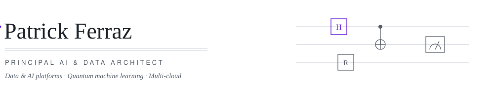

<picture>
  <source media="(prefers-color-scheme: dark)" srcset="assets/header-dark.svg">
  <source media="(prefers-color-scheme: light)" srcset="assets/header-light.svg">
  
</picture>

**Principal AI & Data Architect** · Founder of [Coding4u](https://coding4u.tech) · Quantum ML researcher at CIMATEC

I build data and AI platforms that survive contact with production — lakehouses, GenAI systems
and MLOps pipelines across AWS, Azure and GCP.

<picture>
  <source media="(prefers-color-scheme: dark)" srcset="assets/section-now-dark.svg">
  <source media="(prefers-color-scheme: light)" srcset="assets/section-now-light.svg">
  
</picture>

- Principal consultant at **Coding4u** — lakehouse and multi-agent AI architectures
- MSc researcher at **CIMATEC / LAQCC** — quantum kernels as CFD surrogates
- Teaching AI, big data and HPC at **SENAI CIMATEC**

<picture>
  <source media="(prefers-color-scheme: dark)" srcset="assets/section-work-dark.svg">
  <source media="(prefers-color-scheme: light)" srcset="assets/section-work-light.svg">
  
</picture>

Ten years shipping data and AI. What that looks like in practice:

<table>
  <tr>
    <td><strong>Platforms from&nbsp;zero</strong></td>
    <td>Built a company's first lakehouse twice — founding the data division at an oil &amp; gas
    operator (the team I hired still runs it) and standing one up for a capital-markets fintech,
    governance included.</td>
  </tr>
  <tr>
    <td><strong>GenAI in production</strong></td>
    <td>Multi-agent LLM systems shipped since 2023, before MCP or A2A existed — from a restaurant
    copilot as founding data scientist to a churn-prevention agent system delivered to a university
    network in three months.</td>
  </tr>
  <tr>
    <td><strong>AI where stakes are high</strong></td>
    <td>Award-winning deep learning for COVID-19 screening (<strong>98%</strong> accuracy);
    5G + edge monitoring for mining safety; oil &amp; gas asset platforms (<strong>−30%</strong>
    unplanned downtime).</td>
  </tr>
  <tr>
    <td><strong>Teams that outlast me</strong></td>
    <td>Founded Coding4u — 20+ clients, <strong>178%</strong> average annual growth; co-founded
    FairGame as CTO through MVP; mentor engineers and teach AI at the graduate level.</td>
  </tr>
</table>

<picture>
  <source media="(prefers-color-scheme: dark)" srcset="assets/section-research-dark.svg">
  <source media="(prefers-color-scheme: light)" srcset="assets/section-research-light.svg">
  
</picture>

Fluid-dynamics simulation is expensive, and the data to train cheaper surrogate models is
scarce. My MSc research at CIMATEC / LAQCC asks whether quantum kernels can learn these
non-linear dynamics from small datasets, benchmarked on KUATOMU — CIMATEC's 35-qubit simulator.

<picture>
  <source media="(prefers-color-scheme: dark)" srcset="assets/stack-dark.svg">
  <source media="(prefers-color-scheme: light)" srcset="assets/stack-light.svg">
  
</picture>

<picture>
  <source media="(prefers-color-scheme: dark)" srcset="assets/section-contact-dark.svg">
  <source media="(prefers-color-scheme: light)" srcset="assets/section-contact-light.svg">
  
</picture>

**Available for consulting** via [coding4u.tech](https://coding4u.tech) · open to Principal / Staff
conversations · [LinkedIn](https://www.linkedin.com/in/patricksferraz/) · [Email](mailto:patrick.ferraz@coding4u.tech)
