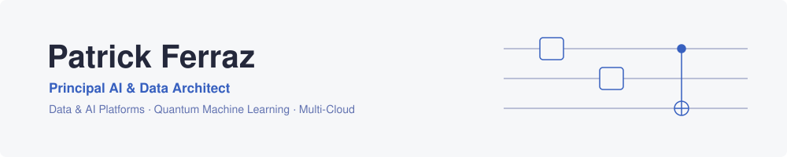

<picture>
  <source media="(prefers-color-scheme: dark)" srcset="img/banner-dark.svg">
  <source media="(prefers-color-scheme: light)" srcset="img/banner-light.svg">
  
</picture>

# Patrick Ferraz

**Principal AI & Data Architect** · Founder [@c4u-tech](https://github.com/c4u-tech) · Quantum ML researcher

I architect Data & AI platforms that make it to production — lakehouses, GenAI systems and
MLOps pipelines across AWS, Azure and GCP. Clients in Oil & Gas, Healthcare, Manufacturing
and Agribusiness. Researching Quantum Machine Learning at CIMATEC.

### Currently

- Principal consultant at **Coding4u** — lakehouse and multi-agent AI architectures
- MSc research at **CIMATEC / LAQCC** — quantum kernels as CFD surrogate models
- Teaching AI, Big Data and HPC in graduate programs at **SENAI CIMATEC**

### Selected work

Client work is not public — the pinned repositories below are where the craft shows.

**Founded the data division at PetroReconcavo** — built it from zero over ~4 years, including
the team that runs it today.

**Industrial monitoring platform** — real-time asset monitoring for oil & gas. **−30% unplanned downtime.**

**Coding4u** — founded and led it to clients across five sectors and **178% average annual
growth**.

**GenAI copilots for restaurants — Natural Bot** — early data scientist. Built the multi-agent
LLM architecture behind the product, before MCP/A2A existed.

### Research · Quantum ML

Quantum kernels for non-linear fluid dynamics — surrogate models targeting quantum advantage in
small-data CFD, benchmarked on CIMATEC's 35-qubit KUATOMU simulator. MSc at CIMATEC · LAQCC fellow.
Earlier: deep learning for COVID-19 screening — awarded research, 98% accuracy.

### Stack

       

### Contact

**Available for consulting** — Data & AI platform work via [coding4u.tech](https://coding4u.tech).
Open to conversations about Principal / Staff roles.

[LinkedIn](https://www.linkedin.com/in/patricksferraz/) · [Email](mailto:patrick.ferraz@coding4u.tech) · [coding4u.tech](https://coding4u.tech)
